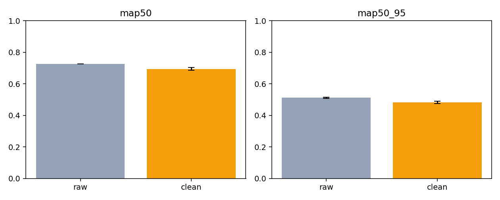
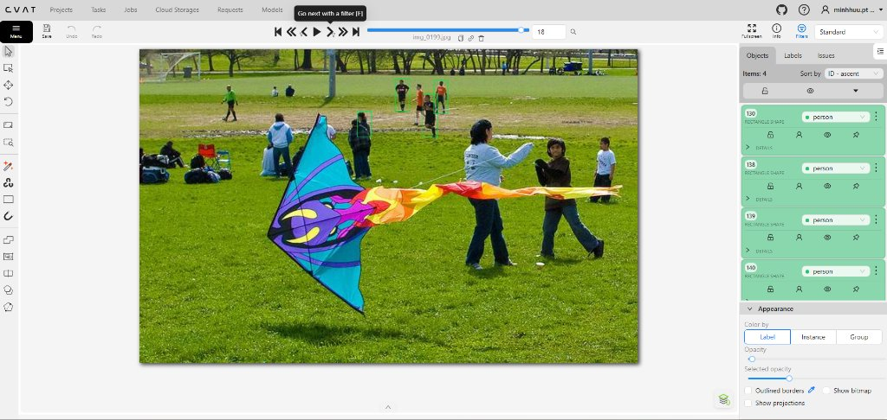

# Báo cáo Day 09 — Đinh Hữu Minh, 2A202603129

## 1. Kết luận trước
Pipeline kiểm nhãn tự động đưa ra kết luận **Hold**.
Toàn bộ lô dữ liệu đầu vào gồm **224 ảnh** thô. Ở Bước 1 (Intake), bộ lọc cửa vào đã loại bỏ **21 ảnh** không đạt chuẩn (ảnh hỏng, quá nhỏ, trùng lặp, rò rỉ tập test/val), đưa **203 ảnh** hợp lệ vào pipeline. Sau vòng tự động sửa lỗi và mô phỏng người duyệt với ngân sách 80 ảnh, pipeline sạch hoàn toàn lỗi bắt buộc (0 ERROR), nhưng còn **44/203 ảnh** (tỉ lệ cảnh báo **21.67%**, vượt ngưỡng quy định **10.00%**) mang cảnh báo ngữ nghĩa chưa được duyệt. Dataset đã được xuất bản nháp (draft) 203 ảnh tại `submission/export/clean_v1/` để phục vụ thử nghiệm và đối chiếu mô hình.

## 2. Lỗi và phân việc
Dưới đây là thống kê toàn bộ các mã lỗi xuất hiện trong lô dữ liệu từ `02_error_list_v1`:

| Mã lỗi | Số ảnh/dòng | Ai sửa (máy/người) | Vì sao |
|---|---:|---|---|
| `CORRUPT_IMAGE` | 2 ảnh | Máy (autofix) | Ảnh hỏng không mở/load được (UnidentifiedImageError, OSError); máy loại bỏ trực tiếp khỏi dataset. |
| `BAD_SIZE` | 3 ảnh | Máy (autofix) | Ảnh có cạnh ngắn < 250px không đủ độ phân giải chuẩn; máy loại bỏ. |
| `DUP_IMAGE_EXACT` | 8 ảnh | Máy (autofix) | Ảnh trùng từng byte (trùng MD5 hash); máy giữ ảnh đầu tiên và loại ảnh trùng sau để tránh thiên lệch. |
| `LEAK_TEST` | 5 ảnh | Máy (autofix) | Ảnh bị rò rỉ từ tập test/gold_val; máy bắt buộc loại bỏ để tránh rò rỉ dữ liệu (data leakage). |
| `DUP_IMAGE_NEAR` | 3 ảnh | Máy (autofix) | Ảnh trùng cấu trúc gần đúng (pHash Hamming distance ≤ 8); máy loại bỏ để tăng tính đa dạng. |
| `BAD_CLASS_NAME` | 2 lỗi | Máy (autofix) | Tên lớp trong `data.yaml` viết hoa sai quy chuẩn ('Person', 'Bus'); máy đổi lại thành 'person', 'bus'. |
| `BAD_FORMAT` | 3 dòng | Máy (autofix) | Dòng nhãn thiếu cột hoặc chứa giá trị không hợp lệ (NaN); máy xóa dòng lỗi. |
| `BAD_CLASS_ID` | 6 dòng | Máy (autofix) | ID lớp nằm ngoài phạm vi 0..3 (vd: 93, 7, 4, -1); máy xóa dòng lỗi. |
| `BOX_ZERO` | 4 dòng | Máy (autofix) | Box có chiều rộng hoặc chiều cao bằng 0 (w=0 hoặc h=0); máy xóa dòng lỗi. |
| `DUP_BOX` | 7 dòng | Máy (autofix) | Box trùng lặp cùng lớp với một box trước đó trong cùng ảnh (IoU > 0.90); máy xóa box xuất hiện sau. |
| `BOX_OUT_OF_IMAGE` | 8 dòng | Máy (autofix) | Box tràn ra ngoài biên [0, 1] quá ngưỡng cho phép (0.002); máy tự động cắt (clip) mép box về trong khung hình. |
| `MISSING_LABEL_FILE` | 6 ảnh | Người (review) | Ảnh chưa có file nhãn; máy không thể tự bịa nhãn mà chuyển người gán (`needs_label`). |
| `EMPTY_LABEL` | 12 ảnh | Người (review) | File nhãn rỗng; máy không thể tự phân định là ảnh nền sạch (background) hay do gán sót, cần người xác nhận. |
| `BOX_TINY` | 6 dòng | Người (review) | Bounding box có cạnh ngắn < 12px; cảnh báo để người xem xét có nên giữ theo guideline dự án. |
| `BOX_HUGE` | 3 dòng | Người (review) | Bounding box chiếm > 95% diện tích ảnh; cảnh báo người kiểm tra xem có bị bao trọn cả khung cảnh. |
| `CLASS_RARE` | 4 ảnh | Người (review) | Cảnh báo xuất hiện lớp có ít mẫu để người duyệt lưu ý phân bố dữ liệu. |
| `POSSIBLE_MISSING` | 68 lỗi | Người (review) | Mô hình checker (yolo26l) phát hiện đối tượng với độ tin cậy cao mà nhãn không có; người duyệt bổ sung nhãn. |
| `POSSIBLE_WRONG_CLASS` | 18 lỗi | Người (review) | Mô hình và nhãn trùng vị trí (IoU ≥ 0.5) nhưng khác lớp; người duyệt xác định lớp chính xác. |
| `POSSIBLE_LOOSE_BOX` | 31 lỗi | Người (review) | Box nhãn và mô hình khớp lớp nhưng lệch mép (IoU < 0.5); người duyệt căn chỉnh lại cho khít vật thể. |
| `POSSIBLE_FALSE_POS` | 25 lỗi | Người (review) | Box nhãn không khớp với bất kỳ dự đoán nào của mô hình; người duyệt kiểm tra xem có gán nhầm vào nền không. |

**Giải thích phân bổ hàng đợi duyệt `05_review_queue.csv`:**
- Hàng đợi ưu tiên xếp các ảnh có mức độ rủi ro cao nhất lên đầu dựa trên trọng số cấu hình: các ảnh thiếu file nhãn `NEEDS_LABEL` có trọng số 10.0 (chặn phát hành), tiếp theo là các ảnh dính nhiều lỗi ngữ nghĩa kết hợp (vd: `img_0020` có priority 14.528, `img_0185` có priority 10.052 kết hợp `FIXED_DROP_LINE`, `POSSIBLE_MISSING`, `POSSIBLE_WRONG_CLASS`).
- Với ngân sách 80 ảnh, toàn bộ 6 ảnh thiếu nhãn và 74 ảnh có cảnh báo ngữ nghĩa nặng nhất (chiếm phần lớn các lỗi missing, wrong class, loose box quan trọng) đã được duyệt và khắc phục thành công. 50 ảnh còn lại nằm ngoài ngân sách (gồm 44 ảnh còn mang cảnh báo) chưa được xem xét, khiến tỉ lệ cảnh báo còn tồn đọng ở mức 21.67%.

## 3. Calibration (2 ngưỡng)
Bảng kết quả hiệu chuẩn trên tập `data/calib/` (39 ảnh có đáp án lỗi chèn cố ý):

| Tham số | Khởi đầu | Đã chọn | Precision / Recall (trước → sau) | Lý do (đánh đổi) |
|---|---|---|---|---|
| `duplicates.phash_dist` | 2 | 8 | (1.00 / 0.50) → (1.00 / 0.67), F1: 0.67 → 0.80 | Tăng khoảng cách Hamming từ 2 lên 8 giúp tăng độ phủ Recall từ 50% lên 67% (bắt thêm 1 cặp ảnh gần trùng bị nén/thu nhỏ), trong khi vẫn giữ Precision tuyệt đối 1.00 (không xóa nhầm ảnh khác nhau). |
| `second_opinion.conf` | 0.25 | 0.50 | MISSING: (0.50 / 1.00) → (0.57 / 1.00), F1: 0.67 → 0.73 | Ngưỡng 0.25 ban đầu quá lỏng, gây ra nhiều báo động giả (FP=8). Tăng lên 0.50 giúp lọc sạch dự đoán nhiễu của checker, Precision tăng từ 50% lên 57% trong khi Recall vẫn giữ trọn vẹn 100% (bắt đủ 8/8 lỗi missing), giúp người duyệt không bị quá tải. |

**Điểm calibration có thể đánh lừa:**
Tập calib chỉ có 39 ảnh với các ca biến đổi nhân tạo. Nếu chỉ tối ưu số liệu thuần túy trên calib, sweep cho thấy `phash_dist = 16` đạt F1 lên tới 0.91 (Recall 83%). Tuy nhiên, khoảng cách Hamming 16/64 bit (chiếm tới 25% sai khác) là quá lớn đối với tập ảnh tự nhiên ngoài thực tế: trên lô raw 224 ảnh, các bức ảnh chụp cùng cung đường hoặc góc chụp tương tự sẽ rất dễ bị đánh đồng là ảnh trùng lặp và bị xóa nhầm ảnh giá trị. Do đó, việc dừng ở ngưỡng `phash_dist = 8` là đánh đổi an toàn và có cơ sở thực tế.

## 4. Cửa chặn và điều pipeline KHÔNG bắt được
**(a) Chứng minh Gate chặn đúng:**
Thực nghiệm kiểm chứng cửa chặn khi không có ngân sách người duyệt (`--budget 0`):
```bash
python -m pipeline.run --budget 0 --reports work/rep_nb --export-dir work/exp_nb
```
* Kết quả: Do không có người duyệt, 6 ảnh thiếu nhãn `MISSING_LABEL_FILE` không được xử lý.
* Gate phát hiện còn nguyên lỗi bắt buộc và lập tức ra kết luận: **REWORK** (`Còn 6 lỗi bắt buộc (Rework)`), trả về mã thoát `20`.
* Pipeline dừng và in rõ: `Bước 5/5  KHÔNG xuất: còn lỗi bắt buộc (Rework) — trả về bước 3`. Thư mục `work/exp_nb` hoàn toàn không được tạo ra. Điều này chứng minh cửa chặn bảo vệ nghiêm ngặt tính toàn vẹn của dữ liệu xuất bản.

**(b) Các điểm mù đã biết của pipeline:**
1. **Bounding box bị lỏng nhẹ (loose box) quanh ngưỡng biên:** Nếu box gán nhãn hơi rộng hơn vật thể một chút nhưng IoU với mô hình checker vẫn đạt khoảng 0.52 – 0.60 (vượt ngưỡng `iou_loose = 0.50`), pipeline sẽ coi là nhãn tốt và bỏ qua.
2. **Lỗi ngữ nghĩa mà cả người gán lẫn mô hình checker đều nhận diện nhầm:** Ví dụ xe bán tải (pickup truck) hoặc xe van bị nhầm lẫn giữa `car` và `truck`. Nếu mô hình yolo26l cũng đưa ra nhãn `car` với độ tin cậy cao, pipeline sẽ đồng thuận (agreement) và bỏ sót lỗi này.
3. **Đối tượng bị che khuất một phần (occlusion) hoặc kích thước rất nhỏ:** Vật thể nhỏ dưới 600 px² bị bộ lọc `min_area_px` bỏ qua để tránh nhiễu, dẫn đến việc nếu người gán bỏ sót vật nhỏ thì pipeline cũng không cảnh báo.

## 5. Train: raw vs clean (tùy chọn, chấm riêng)
Thí nghiệm huấn luyện công bằng trên Google Colab (T4 GPU): cùng model khởi tạo `yolo26n.pt`, 20 epoch, batch size 16, 2 seed (`0`, `1`), cùng tập val (`data/gold_val`, 40 ảnh) và tập test (`data/test`, 100 ảnh nhãn người). Bảng tổng hợp từ `submission/results/comparison.md`:

| biến thể | #ảnh train | số seed | map50 (TB ± độ lệch) | map50_95 (TB ± độ lệch) | precision (TB ± độ lệch) | recall (TB ± độ lệch) |
|---|---:|---:|---|---|---|---|
| `raw` | 224 | 2 | 0.726 ± 0.000 | 0.512 ± 0.004 | 0.764 ± 0.061 | 0.649 ± 0.028 |
| `clean` | 203 | 2 | 0.695 ± 0.010 | 0.482 ± 0.007 | 0.726 ± 0.005 | 0.619 ± 0.016 |

* **Chênh lệch mAP50 (`clean − raw`):** **−0.031** (mức giảm lớn hơn độ lệch chuẩn giữa 2 seed của `clean` là ± 0.010; tuy nhiên nếu nhìn AP50 theo từng lớp: `car` 0.738 → 0.734 và `person` 0.822 → 0.818 gần như tương đương trong nhiễu, `bus` tăng nhẹ 0.695 → 0.704, trong khi riêng lớp `truck` giảm mạnh 0.648 → 0.524 và dao động tới 0.085 giữa seed 0 [0.481] và seed 1 [0.566]).
* **Kết luận trung thực:** Trên tập test hiện tại với 2 seed, **không thể kết luận `clean` cho model tốt hơn `raw`**; ngược lại `mAP50` của `clean` đang thấp hơn `raw` 0.031 chủ yếu do lớp hiếm `truck` và lợi thế rò rỉ dữ liệu của `raw`.
* **Các giả thuyết giải thích và cách kiểm chứng:**
  1. **Rò rỉ tập test (`LEAK_TEST`) thổi phồng điểm của `raw`:** Ở Bước 1, pipeline phát hiện `raw` chứa **5 ảnh trùng trực tiếp với tập test** (`img_0049`/`test_033`, `img_0101`/`test_039`, `img_0167`/`test_044`, `img_0174`/`test_085`, `img_0221`/`test_009`, gồm 12 box `person`, 8 `car` và 1 `truck`). Do `raw` được học thuộc đúng 5% số ảnh của tập test nên chỉ số đo của `raw` bị thổi phồng ảo. *Cách kiểm:* Tạo biến thể `raw_no_leak` (chỉ loại riêng 5 ảnh `LEAK_TEST`) và train lại cùng 2 seed để so sánh công bằng.
  2. **Lớp `truck` rất hiếm (chỉ 41 box trong `class_stats.csv`) và `clean` vẫn đang ở trạng thái Hold:** Khi loại 21 ảnh và còn 44/203 ảnh mang cảnh báo chưa được duyệt hết (trong `07_error_list_v3.txt` vẫn còn 3 cảnh báo nhầm lớp `car`/`truck` và 2 cảnh báo thiếu nhãn `truck`), kết hợp tập test chỉ 100 ảnh, mô hình rất nhạy với phương sai seed trên lớp `truck`. *Cách kiểm:* Duyệt nốt 44 ảnh Hold (đặc biệt các ảnh chứa `truck`), đối chiếu thêm với biến thể `oracle` (nhãn người chuẩn) và tăng số seed lên 3–5.
  3. **Ultralytics tự bỏ qua lỗi cú pháp của `raw`:** Khi nạp `raw`, bộ loader của YOLO tự bỏ các ảnh hỏng và dòng sai định dạng nên `raw` không bị sập khi train.
* **Việc tiếp theo:** Chạy đối chứng `raw_no_leak`, hoàn tất duyệt 44 ảnh còn lại để chuyển lô dữ liệu từ **Hold** sang **Release**, và thu thập bổ sung dữ liệu cho hai lớp ít mẫu (`truck`: 41 box, `bus`: 30 box).



## 6. Quyết định và ghi chú AI
**(a) Quyết định cuối:**
* Quyết định hiện tại của lô: **Hold** (tỉ lệ cảnh báo 21.67% ≥ 10.00%, với 44/203 ảnh còn cảnh báo ngữ nghĩa).
* **Điều kiện để chuyển sang Release:** Cần cấp thêm ngân sách duyệt người (tăng từ 80 ảnh lên khoảng 125 ảnh, tức duyệt thêm ~45 ảnh) để người duyệt xác nhận nốt 44 ảnh còn lại trong hàng đợi `05_review_queue.csv`. Khi tỉ lệ cảnh báo chưa duyệt hạ xuống dưới 10%, pipeline sẽ tự động chuyển sang quyết định Release.

**(b) Ghi chú sử dụng AI:**
* **Prompt chính:** Cung cấp đầy đủ 4 ý theo chuẩn bài giảng: nêu rõ vai trò kiểm tra chất lượng nhãn YOLO, cung cấp docstring chi tiết của từng stub module (`label_format`, `gate`, `autofix`, `second_opinion`), yêu cầu trả về dataclass `Issue` với định dạng trường chuẩn, và liệt kê các ca biên (file rỗng, dòng chứa NaN, box âm, clipping tràn viền).
* **Cách kiểm tra code AI:** Chạy bộ kiểm thử 79 unit tests qua `pytest` (đạt 100% passed), chạy sweep calibration để đối chiếu Precision/Recall trên tập `data/calib/`, và chạy kiểm tra đầu cuối (end-to-end) với pipeline thực tế trên 224 ảnh raw.
* **Một lần AI gợi ý chưa tối ưu:** Trong module `autofix.py`, ban đầu khi xử lý cắt box tràn ảnh (`BOX_OUT_OF_IMAGE`), thuật toán thử tính tọa độ box mới cho cả trường hợp box nằm hoàn toàn ngoài biên âm, tạo ra box có kích thước âm/rỗng; sau khi đối chiếu với `test_box_fully_outside_is_dropped_not_negative`, logic đã được hoàn thiện thành: nếu sau khi clip mà `nw <= 0` hoặc `nh <= 0` thì chuyển action thành `drop_line`.

**(c) Thưởng +2 — Lọc box nhỏ trên CVAT (`width < 20`):**
* **Phạm vi thực hiện:** Tạo project CVAT với nhãn chuẩn từ `cvat/labels.json`, tải lên 20 ảnh đại diện từ `work/run/ds/images/` (gồm 15 ảnh đầu `05_review_queue.csv` và 5 ảnh có `BOX_TINY`), import nhãn định dạng YOLO 1.1 và áp dụng bộ lọc `width < 20`.
* **Kết quả lọc và đối chiếu với `BOX_TINY` của pipeline:**
  * Bộ lọc `width < 20` trên CVAT bắt được **26 box trên 10 ảnh**: `img_0020.jpg` (3), `img_0026.jpg` (6), `img_0051.jpg` (3), `img_0053.jpg` (1), `img_0067.jpg` (1), `img_0069.jpg` (2), `img_0135.jpg` (2), `img_0161.jpg` (3), `img_0183.jpg` (1), `img_0199.jpg` (4).
  * Đối chiếu với `07_error_list_v3.txt`: toàn bộ **5 ảnh (7 box)** bị pipeline cảnh báo `BOX_TINY` (`img_0026`, `img_0051`, `img_0069`, `img_0161`, `img_0183`) đều nằm trọn trong tập 10 ảnh mà CVAT lọc ra. CVAT lọc rộng hơn (thêm 5 ảnh và 19 box, điển hình như 4 box `person` ở xa trên `img_0199.jpg`) do ngưỡng lọc slide dùng `width < 20px` lớn hơn ngưỡng dự án cố định `min_box_px = 12px` trong `configs/pipeline.yaml` (cạnh ngắn < 12px).
* **Thuộc tính `can_review`:** Người gán nhãn đánh dấu `can_review = true` khi gặp đối tượng mơ hồ, khó phân định lớp hoặc bị che khuất để chuyển cho người duyệt cấp trên kiểm tra; trong pipeline tự động, cơ chế tương đương là việc các bộ kiểm cắm cờ mức `WARN` và đẩy ảnh vào hàng đợi ưu tiên `05_review_queue.csv`.


